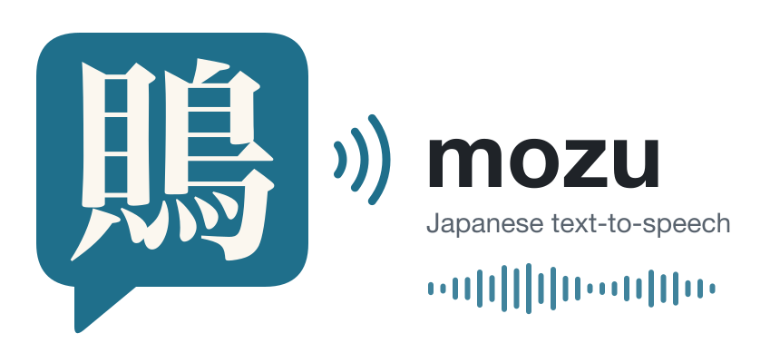

<p align="center">
  
</p>

# mozu

mozu (鵙, bull-headed shrike) is a Japanese text-to-speech (TTS) engine written in Swift for Apple Silicon.

## Usage

```
swift build -c release
.build/release/synthesize -w Models/weights.json -t "こんにちは、本日は晴天なり。" -o out.wav
.build/release/synthesize -w Models/weights.json --voices
.build/release/synthesize -w Models/weights.json -v "female,20代後半" -t "こんにちは" -o out.wav
.build/release/mozu-web -w Models/weights.json --port 8080
```

## Training

```
.build/release/train acoustic -d <corpus> -w Models/weights.json -o Models/weights.json -e 20
.build/release/train vocoder  -d <corpus> -w Models/weights.json -o Models/weights.json -e 50 --gan
```

`train acoustic --mel-gan` adds a mel discriminator, which keeps the predicted mel from being smoothed over time. Without it, frame-to-frame change is about half that of real speech, and the vocoder output sounds rough.

To compare weights against real recordings, choose a fixed evaluation set once and score the weights on it. The comparison is per phoneme for duration, pitch, energy, and mel.

```
.build/release/train evalset  -d <corpus> -w Models/weights.json -o eval.json --count 200
.build/release/train evaluate --set eval.json -m old.json -m new.json --by corpus,gender
.build/release/train acoustic ... --valid-ids eval.json   # keeps the evaluation set out of training
```

A corpus is a directory with `transcript_utf8.txt` (`ID:text` per line), `wav/ID.wav`, an optional `labels.json` (`{"ID": {"kind": "value"}}`, used as voice conditions), and an optional `readings.json` (`{"surface": "reading"}`, for words such as English whose reading the transcript does not tell).

## License

MIT. See [LICENSE](LICENSE).
